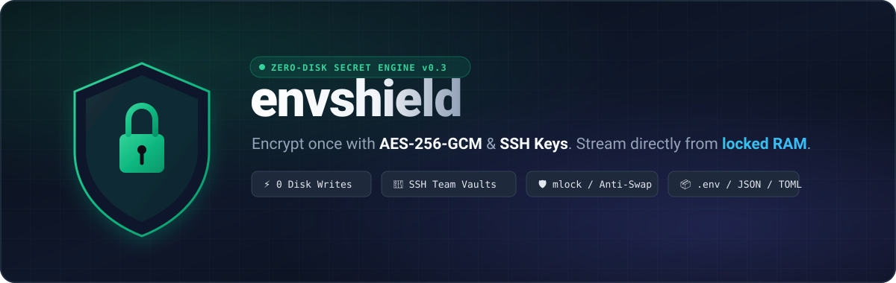
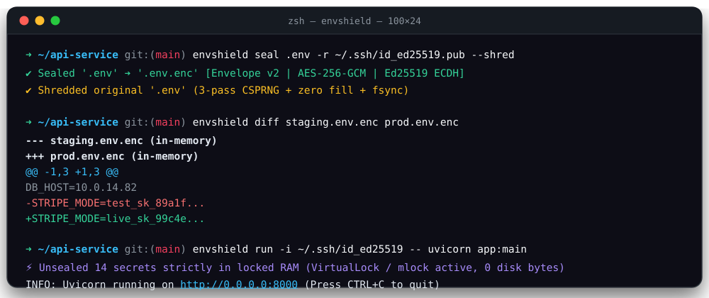
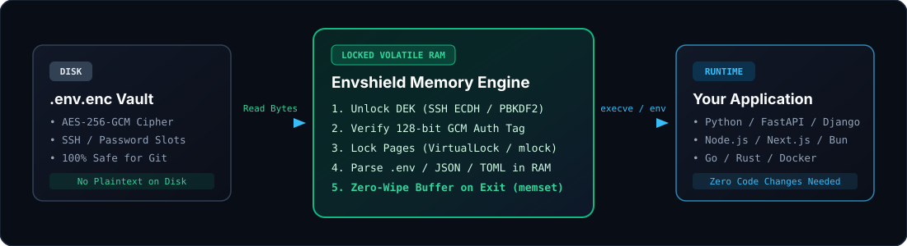

<div align="center">



<br>

[](https://pypi.org/project/envshield-cli/)
[](https://pypi.org/project/envshield-cli/)
[](https://github.com/AmhetCnaa/Envshield)
[](https://github.com/AmhetCnaa/Envshield)
[](LICENSE)

<p align="center">
  <a href="#-30-second-quickstart"><b>Quickstart</b></a> •
  <a href="#-why-envshield"><b>Why Envshield?</b></a> •
  <a href="#-10x-features"><b>10x Superpowers</b></a> •
  <a href="#-command-suite"><b>Command Suite</b></a> •
  <a href="#-enterprise--commercial-licensing"><b>Commercial & Enterprise</b></a> •
  <a href="#-comparison-matrix"><b>Comparison Matrix</b></a> •
  <a href="#-zero-disk-architecture"><b>Architecture</b></a>
</p>



</div>

---

## ⚡ 30-Second Quickstart

```bash
# 1. Install
pip install envshield-cli

# 2. Seal your .env into an encrypted vault & shred the plaintext file
envshield seal .env --shred

# 3. Run any application with secrets injected directly from locked RAM
envshield run -- python app.py
```

> [!TIP]
> **Language Agnostic:** Replace `python app.py` with `npm run dev`, `cargo run`, `go run main.go`, `uvicorn`, or any binary. Your application reads standard environment variables with **zero code changes**.

---

## 🛡️ Why Envshield?

Plaintext `.env` files sitting on developer laptops and CI servers are the #1 source of credential leaks. **Envshield** replaces fragile plaintext files with a hardened, zero-disk cryptographic workflow:

| Traditional `.env` Workflow | The `envshield` Standard |
| :--- | :--- |
| ❌ **Disk Exposure:** Plaintext secrets persist on SSD blocks & backups | ✅ **Zero-Disk Invariant:** Decrypted strictly in volatile RAM; never touches disk |
| ❌ **Accidental Git Leaks:** One `git add .` exposes production keys | ✅ **Self-Healing Git Hook:** Blocks unencrypted secrets and auto-seals with 1 click |
| ❌ **Log & Terminal Leaks:** Stack traces dump keys to stdout/CI logs | ✅ **Live Stream Sanitizer:** Real-time redactor masks secrets as `[REDACTED:KEY]` |
| ❌ **Swap Leaks:** OS kernel pages plaintext memory into `pagefile.sys` | ✅ **Hardware Page Locking:** Memory locked via `VirtualLock` / `mlock` + zero-wiped |
| ❌ **SaaS Dependency:** Forced into monthly subscriptions & cloud servers | ✅ **100% Offline & Decentralized:** Pure asymmetric cryptography & local audit chain |

---

## 🚀 10x Superpowers

### 1. 🛡️ Live Stream Sanitizer (Real-Time Secret Redaction)
When running `envshield run`, child process `stdout` and `stderr` streams are monitored in real-time. If an unexpected exception, stack trace, or debug print attempts to leak secret values, Envshield instantly masks them as `[REDACTED:KEY_NAME]` before they reach the terminal or CI logs.

```bash
# Even if your app does: print(f"Connecting with {os.environ['DB_PASS']}")
# Terminal output will cleanly display:
Connecting with [REDACTED:DB_PASS]
```

### 2. ⚡ Self-Healing Pre-Commit Protection (`hook`)
Never leak an unencrypted `.env` file again:
```bash
envshield hook install
```
If you accidentally stage `.env`, Envshield intercepts the commit and offers to automatically seal it with AES-256-GCM, shred the plaintext file, and stage the encrypted `.env.enc` vault so your commit proceeds safely.

### 3. 🎯 Multi-Environment Profiles & Git Auto-Branching
Manage development, staging, and production in a single vault file without third-party dashboards:
```ini
# .env with sections
APP_NAME=MyApp
[development]
DATABASE_URL=postgres://localhost:5432/dev
[production]
DATABASE_URL=postgres://prod-cluster.internal:5432/main
```
```bash
# Explicit profile selection:
envshield run --profile production -- node server.js

# Or auto-detect based on current Git branch (main -> production):
envshield run --auto-branch -- node server.js
```

### 4. 🔗 Dynamic In-Memory Variable Interpolation
Chain configuration variables recursively in RAM with standard `${VAR}` and `${VAR:-default}` syntax:
```ini
HOST=127.0.0.1
PORT=5432
DATABASE_URL=postgresql://${HOST}:${PORT}/mydb
API_ENDPOINT=${API_URL:-https://api.internal}/v1
```

### 5. 📜 Cryptographic Tamper-Evident Audit Trail
Comply with SOC 2, ISO 27001, and regulatory audits without deploying heavy server infrastructure:
```bash
# View verifiable access history
envshield audit list

# Cryptographically verify the HMAC hash chain integrity
envshield audit verify
```

### 6. 🍯 Canary Honeypot & Decoy Sandbox
If an attacker attempts unauthorized decryption, trigger a decoy trap:
```bash
# If wrong password entered, inject inert canary credentials & alert security webhook
envshield run --enable-decoy --alert-webhook https://alerts.internal/webhook -- ./app
```

### 7. 🐳 Docker & Container Zero-Disk Bridge (`docker`)
Run Docker containers and Docker Compose services with secrets injected from RAM without exposing plaintext variables in `docker inspect`:
```bash
# Standard in-memory injection for docker run (no unencrypted .env file needed on host):
envshield docker run -d -p 8080:80 nginx

# Stealth mode (hides secrets from `docker inspect <container>` using tmpfs RAM mount):
envshield docker --stealth -- run -d my-secure-app

# Docker compose zero-disk injection:
envshield docker compose up -d
```

### 8. ☁️ Cloud KMS & CI/CD Hybrid Envelope (`kms` & `ci`)
Eliminate hardcoded master passwords and secrets from GitHub Actions repository settings. Envshield supports multi-recipient envelopes combining developer SSH keys with AWS KMS, GCP Cloud KMS, Azure Key Vault, or HashiCorp Vault:

```bash
# Seal a vault for local developer SSH keys AND cloud AWS KMS in CI/CD:
envshield seal .env -r ~/.ssh/id_ed25519.pub --kms arn:aws:kms:eu-central-1:123456789:key/xxx

# Inspect attached cloud KMS recipients:
envshield kms list

# Test KMS permissions and connectivity before deploying:
envshield kms test arn:aws:kms:eu-central-1:123456789:key/xxx

# Bootstrap a production-ready GitHub Actions OIDC workflow:
envshield ci init --provider github -o .github/workflows/envshield.yml
```
* **On Developer Laptop:** Unlocks in 1ms using local `~/.ssh/id_ed25519` key with zero cloud network requests.
* **In GitHub Actions / AWS:** Automatically unlocks via AWS IAM OIDC role with zero master passwords stored in repo settings!

### 9. 📟 Interactive PTY Runner (`run -t / --pty`)
Run full-screen, interactive terminal sessions (e.g., `bash`, `zsh`, `psql`, `mysql`, `vim`, or `htop`) with complete ANSI escape codes, cursor navigation, window resize (SIGWINCH), and ConPTY support on Windows:
```bash
envshield run -t -- psql "postgresql://${DB_USER}:${DB_PASS}@${DB_HOST}/db"
```

---

## 👥 Team SSH Workflow & GitHub Integration

Stop sharing master passwords across Slack or 1Password vaults. Envshield's **Envelope v2** cryptography and `team` engine allows instant developer onboarding using their public keys from GitHub or disk:

```bash
# 1. Onboard a teammate using their GitHub username (auto-fetches public SSH keys & re-seals repo vaults)
envshield team add ahmet --github

# 2. Add an operations key from a local public key file
envshield team add devops-ci -k ~/.ssh/deploy_rsa.pub

# 3. View the current team recipient roster
envshield team list

# 4. Offboard a member and immediately revoke access across all repository vaults
envshield team remove ahmet
```

Each authorized developer unlocks and runs the project using their own local SSH private key with zero configuration:

```bash
envshield run -i ~/.ssh/id_ed25519 -- npm start
```

---

## 🧰 Command Suite

<table>
<tr>
<td width="50%" valign="top">

### 🔒 `envshield seal`
Encrypt `.env`, `.json`, `.toml`, or `.yaml` files into authenticated `.enc` vaults.
```bash
# Seal with password + shred original
envshield seal .env --shred

# Seal with SSH recipient key
envshield seal .env -r ~/.ssh/id_ed25519.pub
```

</td>
<td width="50%" valign="top">

### 🚀 `envshield run`
Inject in-memory secrets with live stream redaction & dynamic interpolation.
```bash
# Run with automatic git branch profile
envshield run --auto-branch -- python app.py

# Run specific profile with custom identity
envshield run -p prod -i ~/.ssh/id_ed25519 -- ./bin
```

</td>
</tr>
<tr>
<td width="50%" valign="top">

### 🪝 `envshield hook`
Install and manage self-healing git pre-commit hooks to block credential leaks.
```bash
# Install self-healing hook
envshield hook install

# Remove hook
envshield hook uninstall
```

</td>
<td width="50%" valign="top">

### 📜 `envshield audit`
Inspect and verify the cryptographic tamper-evident access log.
```bash
# Inspect recent secret access events
envshield audit list

# Verify hash chain integrity
envshield audit verify
```

</td>
</tr>
<tr>
<td width="50%" valign="top">

### 📝 `envshield edit`
Modify encrypted secrets in-place inside `$EDITOR` (`vim`, `nano`, `code`, `notepad`).
```bash
# Opens isolated buffer & shreds on exit
envshield edit .env.enc
```

</td>
<td width="50%" valign="top">

### 👥 `envshield team`
Onboard teammates via GitHub and automatically re-seal all project vaults.
```bash
# Add teammate from GitHub & sync vaults
envshield team add ahmet --github

# List team members and keys
envshield team list

# Revoke member access & re-seal
envshield team remove ahmet
```

</td>
</tr>
<tr>
<td width="50%" valign="top">
 
### 🐳 `envshield docker`
Run Docker and Compose services with zero-disk injection & inspect immunity.
```bash
# Standard in-memory docker run
envshield docker run -p 80:80 nginx

# Stealth mode (hides from docker inspect)
envshield docker --stealth -- run my-app

# Docker compose zero-disk injection
envshield docker compose up -d
```

</td>
<td width="50%" valign="top">

### 🔍 `envshield diff`
Compare two encrypted vaults or inspect changes in RAM with colored unified diffs.
```bash
# Compare staging vs production vaults in RAM
envshield diff staging.env.enc prod.env.enc
```

</td>
</tr>
<tr>
<td width="50%" valign="top">

### ☁️ `envshield kms`
Manage Cloud KMS envelope recipients for passwordless CI/CD & production unlocks.
```bash
# List attached KMS keys
envshield kms list

# Attach AWS KMS key ARN to existing vault
envshield kms add arn:aws:kms:us-east-1:...

# Test KMS connectivity and permissions
envshield kms test arn:aws:kms:us-east-1:...
```

</td>
<td width="50%" valign="top">

### ⚙️ `envshield ci`
Generate production-ready CI/CD workflows with OIDC & KMS integration.
```bash
# Generate GitHub Actions workflow with AWS OIDC
envshield ci init --provider github -o .github/workflows/envshield.yml

# Generate GitLab CI snippet
envshield ci init --provider gitlab
```

</td>
</tr>
<tr>
<td width="50%" valign="top">

### 🔍 `envshield drift`
Detect missing variables, dead secrets, and staging vs production profile discrepancies.
```bash
# Analyze codebase and vault for drift
envshield drift .env.enc

# CI pipeline enforcement (exit code 1 on drift)
envshield drift .env.enc --ci
```

</td>
<td width="50%" valign="top">

### 📋 `envshield audit report`
Generate executive SOC 2 / ISO 27001 HTML verification reports with cryptographic HMAC proof.
```bash
# Generate standalone compliance certificate
envshield audit report -o soc2_report.html
```

</td>
</tr>
</table>

---

## 💼 Enterprise & Commercial Licensing

Envshield is dual-licensed to support both the open-source community and commercial organizations:

* **Community Edition (GNU AGPLv3 - $0 Forever):** Full open source for developers, personal projects, and open-source applications.
* **Team Edition ($19 / user / month):** Commercial AGPLv3 copyleft waiver, real-time SIEM webhook streaming (Datadog, Splunk, Slack), and automated secret drift sentinel.
* **Enterprise Edition (Custom Contract):** Unlimited seats, automated SOC 2 / ISO 27001 compliance audit reports, 24/7 dedicated Slack/Teams support, custom HSM & PKCS#11 hardware key integrations.

👉 **View complete licensing models and SLA details in [COMMERCIAL.md](COMMERCIAL.md)** or contact `licensing@envshield.security`.

---

## 📊 Comparison Matrix

| Capability | `envshield` | `dotenv` | `sops` | `Doppler` | `HashiCorp Vault` | `1Password CLI` |
| :--- | :---: | :---: | :---: | :---: | :---: | :---: |
| **100% RAM-Only Injection** | ✅ | ❌ | ⚠️ Partial | ✅ | ✅ | ✅ |
| **Live Stream Redaction (Stdout/Stderr)**| ✅ | ❌ | ❌ | ⚠️ Cloud Only | ❌ | ❌ |
| **Cloud KMS & CI/CD Envelope** | ✅ (AWS/GCP/Azure/Vault) | ❌ | ✅ (Config Heavy) | ⚠️ Cloud Only | ⚠️ Heavy Server | ❌ |
| **Self-Healing Git Pre-Commit Hook** | ✅ | ❌ | ❌ | ❌ | ❌ | ❌ |
| **Docker `inspect` Stealth Bridge** | ✅ | ❌ | ❌ | ❌ (Extra Binary)| ⚠️ Agent Required | ❌ |
| **GitHub Team Key Sync (`team add`)** | ✅ | ❌ | ❌ | ⚠️ Cloud Only | ❌ | ❌ |
| **Local Tamper-Evident Audit Chain** | ✅ | ❌ | ❌ | ⚠️ Cloud Only | ⚠️ Heavy Server | ❌ |
| **Multi-Profile Single Envelope** | ✅ | ❌ | ❌ | ⚠️ Cloud Only | ⚠️ Heavy Server | ❌ |
| **Dynamic In-Memory Interpolation** | ✅ | ❌ | ❌ | ✅ | ❌ | ⚠️ Basic |
| **Honeypot Decoy Mode & Webhook** | ✅ | ❌ | ❌ | ❌ | ❌ | ❌ |
| **Interactive PTY / ConPTY Runner** | ✅ | ❌ | ❌ | ❌ | ❌ | ❌ |
| **SSH Public Key Recipients** | ✅ | ❌ | ✅ | ❌ | ❌ | ❌ |
| **Zero Infrastructure / Offline** | ✅ | ✅ | ✅ | ❌ Cloud | ❌ Server | ❌ Cloud |
| **Cold-Start Overhead** | **< 20 ms** | ~ 5 ms | ~ 60 ms | ~ 150 ms | ~ 200 ms | ~ 120 ms |

---

## 🧠 Zero-Disk Architecture

<div align="center">
  
</div>

---

<details>
<summary><b>🔬 Deep Dive: Cryptographic Specifications & Python API</b></summary>
<br>

### Cryptographic Primitives
* **AEAD Payload Cipher:** `AES-256-GCM` with 96-bit CSPRNG nonces and 128-bit authentication tags.
* **Key Derivation:** `PBKDF2-HMAC-SHA256` (100,000 iterations, 16-byte random salt).
* **Asymmetric Key Exchange:** Ephemeral-Static `X25519` ECDH (via birational Ed25519 curve mapping) + `HKDF-SHA256`, and `RSA-OAEP-SHA256`.
* **Forensic Sanitization:** 3-pass random overwrite (`os.urandom`), zero-fill pass (`0x00`), `os.fsync()` hardware cache flush, and `ctypes.memset` RAM zeroing.
* **Audit Chaining:** `HMAC-SHA256` continuous Merkle-linked event log with integrity verification.

### Python SDK Usage
```python
from pathlib import Path
from envshield.core.vault import seal_file, unseal_to_memory
from envshield.core.runner import execute_with_env

# Encrypt file with envelope v2
seal_file(Path(".env"), Path(".env.enc"), password="MasterPassword123!")

# Decrypt directly into a Python dictionary in RAM (zero disk writes)
secrets = unseal_to_memory(
    Path(".env.enc"),
    password="MasterPassword123!",
    profile="production",
    interpolate=True,
)

# Run command with injected environment & live stream secret redaction
exit_code = execute_with_env(["python", "worker.py"], secrets, redact=True)
```

</details>

---

<div align="center">
  <sub>Dual-licensed under the <a href="LICENSE">GNU AGPLv3</a> (Community) and Commercial Enterprise Terms. See <a href="COMMERCIAL.md">COMMERCIAL.md</a>.</sub>
</div>
